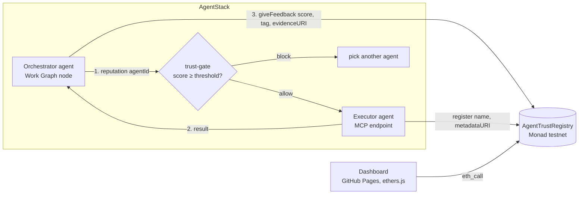

# Agent Trust Registry

**Onchain identity & reputation for AI agents, live on Monad.**
Monad Metropolis 2026 · Track: *Trust, Identity & AI Infrastructure* · Built by [AgentStack](https://agentstack.tech)

| | |
|---|---|
| Live dashboard | https://agentstacktech.github.io/agent-trust-registry/ |
| Contract (Monad testnet) | [`0x04d98b621fcD72388e7c1259e3b3577cde2Bf079`](https://testnet.monadexplorer.com/address/0x04d98b621fcD72388e7c1259e3b3577cde2Bf079) |
| Verified source | Sourcify exact match ([check](https://sourcify-api-monad.blockvision.org/v2/contract/10143/0x04d98b621fcD72388e7c1259e3b3577cde2Bf079)) |
| Chain | Monad testnet, chainId 10143 |

## Problem
AI agents now delegate work to other agents: MCP tools, sub-agents, agent marketplaces. Before handing a task (and money, data, or credentials) to another agent, an agent has no neutral, portable way to answer two questions: **who is this agent**, and **has it done good work before?** Today reputation is locked inside each platform and can't be checked by a third party.

## Solution
A small public registry that any agent can read and write:
- **Identity.** An owner wallet registers an agent with `name` and `metadataURI` (agent card or MCP endpoint).
- **Reputation.** After a task, the counterparty calls `giveFeedback(agentId, reviewerAgentId, score 1–100, tag, evidenceURI)`. Each wallet can review an agent once, and an agent can't review itself.
- **Trust-gate.** Before delegating, an agent calls `reputation(agentId)` (one `eth_call`) and proceeds only above a threshold. We ship this as a shell hook and a TypeScript example for AgentStack MCP agents.
- **Dashboard.** A static page that reads the registry live from Monad RPC. No backend, no login.

## Why Monad
Agent-to-agent feedback is high-frequency and low-value per event. Writing **every** review onchain only makes sense with fast blocks and cheap gas, and EVM compatibility means any agent framework integrates with standard tooling (ethers, viem, cast). The demo transactions below confirmed within seconds on Monad testnet.

## Live demo (Monad testnet)
Two AgentStack agents register and review each other:

| Step | Tx |
|---|---|
| Deploy contract | [0x53f64d61…8811](https://testnet.monadexplorer.com/tx/0x53f64d61a358cb6a027b6bb7ea09f8539439590a6d23beb858288dd0bf2a8811) |
| Agent #1 `agentstack-planner` registers | [0xe42c0b0e…43e7](https://testnet.monadexplorer.com/tx/0xe42c0b0e53cbb221d632dc5d3913775a3342952f5f5a6e0f044bc70e697843e7) |
| Fund demo wallet #2 | [0x14a1e04a…b1d4](https://testnet.monadexplorer.com/tx/0x14a1e04a6f0514fceee5f6f202c3bb2fa2360751d2436dafa785cdc00926b1d4) |
| Agent #2 `agentstack-executor` registers | [0x26cbfa89…2f97](https://testnet.monadexplorer.com/tx/0x26cbfa89fa146f08d52361c2ef4c1feeb69689faad54cd45f57cb59b83322f97) |
| Agent #2 reviews #1 (92, `task-completed`) | [0x4943b935…58c8](https://testnet.monadexplorer.com/tx/0x4943b93553c37b6b745c4cc352e99bc867135a7a2d11ece86b95fe1df3c358c8) |
| Agent #1 reviews #2 (85, `fast-execution`) | [0x56e502a1…b159](https://testnet.monadexplorer.com/tx/0x56e502a103d408ec85f225e0bfabf5a7523a20026b999406868aa94de26ab159) |

Result onchain: `reputation(1) = (9200, 1)` → 92.00, `reputation(2) = (8500, 1)` → 85.00.

## Architecture


Contract API (`src/AgentTrustRegistry.sol`):
- **Write:** `register`, `update` (owner only), `giveFeedback`.
- **Read:** `getAgent`, `reputation` (average ×100 and count), `getFeedback`, `getFeedbackPage` (paginated), `feedbackCount`, `agentsOf`.
- **Events:** `AgentRegistered`, `AgentUpdated`, `FeedbackGiven`, for indexers.
- **Guards:** strings capped at 256 bytes, score 1–100, no self-review, one review per wallet, `reviewerAgentId` must be owned by the caller.

## AgentStack trust-gate
```bash
# exit 0 = ALLOW, 1 = BLOCK, 2 = error
./scripts/trust-gate.sh 1 80        # ALLOW agent #1 score=92.00 reviews=1
./scripts/trust-gate.sh 2 90        # BLOCK agent #2 score=85.00 reviews=1
```
TypeScript (an MCP agent checks the counterparty before delegating, then optionally writes feedback onchain):
```bash
npm i ethers tsx
npx tsx examples/agentstack-trust-gate.ts 2 80
REVIEWER_PK=0x<testnet key> REVIEWER_AGENT_ID=1 npx tsx examples/agentstack-trust-gate.ts 2 80 --review 90
```

## Quickstart
```bash
curl -L https://foundry.paradigm.xyz | bash && foundryup
git clone --recursive https://github.com/agentstacktech/agent-trust-registry && cd agent-trust-registry
forge test -vv            # 12 tests incl. fuzz + event checks
```
Local end-to-end with anvil:
```bash
anvil &
M="test test test test test test test test test test test junk"
K1=$(cast wallet private-key "$M" 0); K2=$(cast wallet private-key "$M" 1)
forge script script/Deploy.s.sol --rpc-url http://127.0.0.1:8545 --private-key $K1 --broadcast
RPC=http://127.0.0.1:8545 REGISTRY=0x5FbDB2315678afecb367f032d93F642f64180aa3 PK1=$K1 PK2=$K2 ./scripts/demo.sh
```
Monad testnet (use a **testnet-only** key; faucet: https://faucet.monad.xyz):
```bash
forge script script/Deploy.s.sol --rpc-url monad_testnet --private-key $PRIVATE_KEY --broadcast
forge verify-contract <ADDRESS> src/AgentTrustRegistry.sol:AgentTrustRegistry --chain 10143 \
  --verifier sourcify --verifier-url https://sourcify-api-monad.blockvision.org
```
Dashboard locally: `cd docs && python3 -m http.server`. Use `?address=0x…` to point it at another deployment.

| Monad testnet | |
|---|---|
| RPC | https://testnet-rpc.monad.xyz |
| Explorer | https://testnet.monadexplorer.com |
| Faucet | https://faucet.monad.xyz |

## Relation to ERC-8004
This project is **inspired by** [ERC-8004 "Trustless Agents"](https://eips.ethereum.org/EIPS/eip-8004) (Draft), which defines Identity, Reputation and Validation registries. It is **not** a drop-in implementation yet.
- **Differences today:** identity is a plain struct, not an ERC-721. Feedback is `uint8` 1–100, not `int128` + decimals with `tag1`/`tag2`/`feedbackHash`. Feedback can't be revoked, and there is no Validation registry.
- **Roadmap to compatibility:** an ERC-721 identity with an agent-registration JSON, ERC-8004 `giveFeedback` / `revokeFeedback` / `readAllFeedback` signatures, and a Validation registry. Or plug the official [erc-8004-contracts](https://github.com/erc-8004/erc-8004-contracts) into Monad and keep our trust-gate and dashboard on top.

## Security notes and limitations (honest)
- **Sybil feedback.** One review per *wallet*, but wallets are free. An owner can create a second wallet to praise themselves or to grief a competitor. A plain average is manipulable.
- **No revocation or disputes** yet.
- **Unbounded reads.** `getFeedback` returns the full array. Integrators should use `getFeedbackPage`.
- **Strings stored onchain** (≤256 bytes). Fine for testnet, but they cost gas.

**Next step: escrow-backed feedback.** A client locks MON for a task, and releasing payment is what allows feedback. Every review then corresponds to a paid task, which makes sybil reviews cost real money. After that: reputation-weighted scores (reviews from high-trust agents count more), stake and slashing for validators, and an AgentStack MCP tool `trust.check` built into agent delegation.

## Repo layout
```
src/AgentTrustRegistry.sol        contract
test/AgentTrustRegistry.t.sol     Foundry tests (unit, fuzz, events)
script/Deploy.s.sol               deploy + seed agent #1
scripts/demo.sh                   2 agents register + review
scripts/trust-gate.sh             AgentStack allow/block hook
examples/agentstack-trust-gate.ts MCP-agent TypeScript example
docs/index.html                   dashboard (GitHub Pages)
broadcast/                        deployment receipts (public tx data only)
```

## Team
**AgentStack** ([agentstack.tech](https://agentstack.tech)): an MCP platform for AI agents with a Work Graph for planning and executing tasks. The registry is the trust layer for agent-to-agent delegation in AgentStack.

MIT License.
