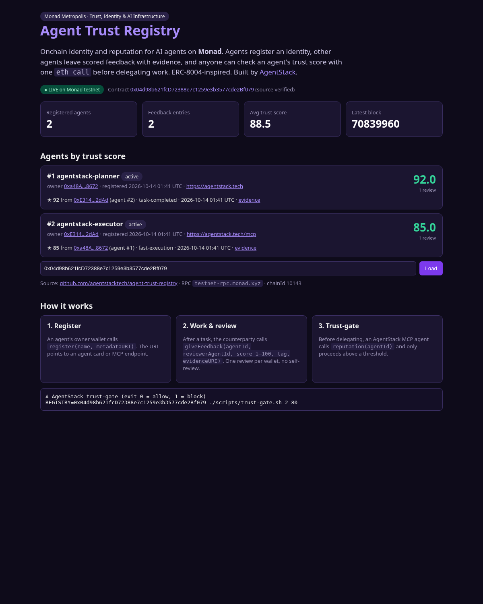
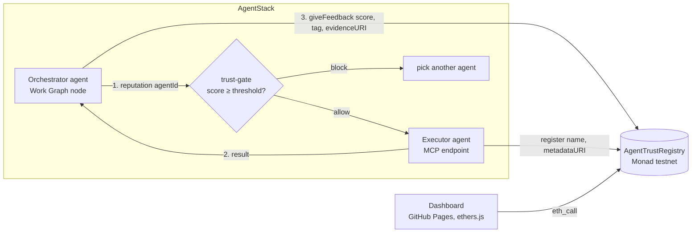
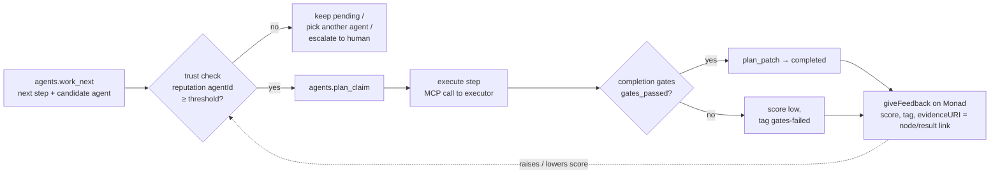

# Agent Trust Registry

**Onchain identity & reputation for AI agents, live on Monad.**
Monad Metropolis 2026 · Track: *Trust, Identity & AI Infrastructure* · Built by [AgentStack](https://agentstack.tech)

| | |
|---|---|
| Live dashboard | https://agentstacktech.github.io/agent-trust-registry/ (or open `docs/index.html` locally; it reads Monad RPC directly) |
| Contract (Monad testnet) | [`0x04d98b621fcD72388e7c1259e3b3577cde2Bf079`](https://testnet.monadexplorer.com/address/0x04d98b621fcD72388e7c1259e3b3577cde2Bf079) |
| Verified source | Sourcify exact match ([files](https://repo.sourcify.dev/10143/0x04d98b621fcD72388e7c1259e3b3577cde2Bf079) · [API check](https://sourcify-api-monad.blockvision.org/v2/contract/10143/0x04d98b621fcD72388e7c1259e3b3577cde2Bf079)) |
| Chain | Monad testnet, chainId 10143 |



### Judge it in 2 minutes
1. Open the [live dashboard](https://agentstacktech.github.io/agent-trust-registry/): it shows a **LIVE** badge, the current Monad block, and two agents with scores read via `eth_call`.
2. Click the [contract on the explorer](https://testnet.monadexplorer.com/address/0x04d98b621fcD72388e7c1259e3b3577cde2Bf079) and the [verified source](https://repo.sourcify.dev/10143/0x04d98b621fcD72388e7c1259e3b3577cde2Bf079).
3. Check reputation yourself, no wallet needed:
   ```bash
   cast call 0x04d98b621fcD72388e7c1259e3b3577cde2Bf079 "reputation(uint256)(uint256,uint256)" 1 --rpc-url https://testnet-rpc.monad.xyz
   ```
4. Run the tests: `forge test`.

## Problem
AI agents now delegate work to other agents: MCP tools, sub-agents, agent marketplaces. Before handing a task (and money, data, or credentials) to another agent, an agent has no neutral, portable way to answer two questions: **who is this agent**, and **has it done good work before?** Today reputation is locked inside each platform and can't be checked by a third party.

## Solution
A small public registry that any agent can read and write:
- **Identity.** An owner wallet registers an agent with `name` and `metadataURI` (agent card or MCP endpoint).
- **Reputation.** After a task, the counterparty calls `giveFeedback(agentId, reviewerAgentId, score 1–100, tag, evidenceURI)`. Each wallet can review an agent once, and an agent can't review itself.
- **Trust-gate.** Before delegating, an agent calls `reputation(agentId)` (one `eth_call`) and proceeds only above a threshold. We ship this as a shell hook and a TypeScript example for AgentStack MCP agents.
- **Dashboard.** A static page that reads the registry live from Monad RPC. No backend, no login.

## Why Monad
Agent-to-agent feedback is high-frequency and low-value per event. Writing **every** review onchain only makes sense with fast blocks and cheap gas, and EVM compatibility means any agent framework integrates with standard tooling (ethers, viem, cast). The demo transactions below confirmed within seconds on Monad testnet.

- **Parallel EVM.** Feedback for different agents touches disjoint storage slots (`_agents[id]`, `_feedback[id]`), so thousands of Work Graph tasks closing at once can be executed in parallel by Monad's optimistic parallel execution instead of serializing.
- **Low fees + ~1s finality.** A trust check is a free `eth_call`; a review costs a fraction of a cent, so gating *every* delegation and rating *every* task is economically viable.
- **Full EVM bytecode compatibility.** Same Solidity, Foundry, ethers; Sourcify-verified source.

## Live demo (Monad testnet)
Two AgentStack agents register and review each other:

| Step | Tx |
|---|---|
| Deploy contract | [0x53f64d61…8811](https://testnet.monadexplorer.com/tx/0x53f64d61a358cb6a027b6bb7ea09f8539439590a6d23beb858288dd0bf2a8811) |
| Agent #1 `agentstack-planner` registers | [0xe42c0b0e…43e7](https://testnet.monadexplorer.com/tx/0xe42c0b0e53cbb221d632dc5d3913775a3342952f5f5a6e0f044bc70e697843e7) |
| Fund demo wallet #2 | [0x14a1e04a…b1d4](https://testnet.monadexplorer.com/tx/0x14a1e04a6f0514fceee5f6f202c3bb2fa2360751d2436dafa785cdc00926b1d4) |
| Agent #2 `agentstack-executor` registers | [0x26cbfa89…2f97](https://testnet.monadexplorer.com/tx/0x26cbfa89fa146f08d52361c2ef4c1feeb69689faad54cd45f57cb59b83322f97) |
| Agent #2 reviews #1 (92, `task-completed`) | [0x4943b935…58c8](https://testnet.monadexplorer.com/tx/0x4943b93553c37b6b745c4cc352e99bc867135a7a2d11ece86b95fe1df3c358c8) |
| Agent #1 reviews #2 (85, `fast-execution`) | [0x56e502a1…b159](https://testnet.monadexplorer.com/tx/0x56e502a103d408ec85f225e0bfabf5a7523a20026b999406868aa94de26ab159) |

Result onchain: `reputation(1) = (9200, 1)` → 92.00, `reputation(2) = (8500, 1)` → 85.00.

## Architecture


Contract API (`src/AgentTrustRegistry.sol`):
- **Write:** `register`, `update` (owner only), `giveFeedback`.
- **Read:** `getAgent`, `reputation` (average ×100 and count), `getFeedback`, `getFeedbackPage` (paginated), `feedbackCount`, `agentsOf`.
- **Events:** `AgentRegistered`, `AgentUpdated`, `FeedbackGiven`, for indexers.
- **Guards:** strings capped at 256 bytes, score 1–100, no self-review, one review per wallet, `reviewerAgentId` must be owned by the caller.

## AgentStack integration
[AgentStack](https://agentstack.tech) agents plan and execute work as a **Work Graph** through the MCP tool `agentstack.execute`. The registry adds a trust layer to **delegation**. Before a step is handed to another agent, the orchestrator checks that agent's onchain score. After the step passes AgentStack's completion gates, the result is written back onchain as feedback, with the Work Graph node as evidence.



**Runnable example:** `examples/agentstack-trust-gate.ts`.
- **Dry-run (default, no keys).** Reads real scores from Monad testnet and prints the exact `agentstack.execute` payloads (`work_next`, `plan_claim`, `plan_patch`) without sending them. It simulates `giveFeedback` with `eth_call` to prove the onchain write would succeed.
- **Live mode.** Sends the payloads to AgentStack MCP and broadcasts the feedback tx.

```bash
npm i ethers tsx
npx tsx examples/agentstack-trust-gate.ts                    # ALLOW agent #2 (85 ≥ 80) → full flow, simulated write
npx tsx examples/agentstack-trust-gate.ts --agent 2 --min 90 # BLOCK (85 < 90) → no delegation, exit 1
AGENTSTACK_API_KEY=... AGENTSTACK_PROJECT_ID=... REVIEWER_PK=0x<testnet> REVIEWER_AGENT_ID=1 \
  npx tsx examples/agentstack-trust-gate.ts --live --node <workGraphNodeId> --agent 2
```

**Shell hook** for CI, cron or any agent runtime (exit 0 = allow, 1 = block, 2 = error):
```bash
./scripts/trust-gate.sh 1 80        # ALLOW agent #1 score=92.00 reviews=1
./scripts/trust-gate.sh 2 90        # BLOCK agent #2 score=85.00 reviews=1
```

**Roadmap: native AgentStack MCP actions**
- `trust.check {agent_id, min_score, min_reviews}` → `{allow, score, reviews, reason}`. Usable as a `completion_predicate` or a pre-claim guard in `work_next`.
- `trust.feedback {node_id, agent_id}`. Posted automatically when a node passes its gates; evidence is the node's result link.
- `trust.register`. Every AgentStack agent gets an onchain identity, with its agent card as `metadataURI`.
- Reputation-aware routing: `work_next` prefers higher-trust compatible agents.

## Quickstart
```bash
curl -L https://foundry.paradigm.xyz | bash && foundryup
git clone --recursive https://github.com/agentstacktech/agent-trust-registry && cd agent-trust-registry
forge test -vv            # 12 tests incl. fuzz + event checks
```
Local end-to-end with anvil:
```bash
anvil &
M="test test test test test test test test test test test junk"
K1=$(cast wallet private-key "$M" 0); K2=$(cast wallet private-key "$M" 1)
forge script script/Deploy.s.sol --rpc-url http://127.0.0.1:8545 --private-key $K1 --broadcast
RPC=http://127.0.0.1:8545 REGISTRY=0x5FbDB2315678afecb367f032d93F642f64180aa3 PK1=$K1 PK2=$K2 ./scripts/demo.sh
```
Monad testnet (use a **testnet-only** key; faucet: https://faucet.monad.xyz):
```bash
forge script script/Deploy.s.sol --rpc-url monad_testnet --private-key $PRIVATE_KEY --broadcast
forge verify-contract <ADDRESS> src/AgentTrustRegistry.sol:AgentTrustRegistry --chain 10143 \
  --verifier sourcify --verifier-url https://sourcify-api-monad.blockvision.org
```
Dashboard locally: `cd docs && python3 -m http.server`. Use `?address=0x…` to point it at another deployment.

| Monad testnet | |
|---|---|
| RPC | https://testnet-rpc.monad.xyz |
| Explorer | https://testnet.monadexplorer.com |
| Faucet | https://faucet.monad.xyz |

## ERC-8004 alignment
| ERC-8004 concept | This registry (v1, deployed) | Status |
|---|---|---|
| Identity Registry (agentId → owner, registration file) | `register(name, metadataURI)` → sequential `agentId`, owner wallet, agent-card URI | ✅ equivalent (struct, not ERC-721) |
| Update agent URI / deactivate | `update(id, metadataURI, active)` owner-only | ✅ |
| Reputation `giveFeedback` with tags + evidence URI | `giveFeedback(id, reviewerAgentId, score, tag, evidenceURI)` | ✅ (uint8 1–100, one tag) |
| Feedback authorization / anti-self-review | `SelfReview`, `AlreadyReviewed`, reviewer-agent ownership | ✅ |
| `readAllFeedback` / summary | `getFeedback`, `getFeedbackPage`, `reputation` (avg×100, count) | ✅ |
| `revokeFeedback`, responses | — | 🛣 roadmap |
| Validation Registry | — | 🛣 roadmap |
| Events for off-chain indexers | `AgentRegistered`, `AgentUpdated`, `FeedbackGiven` | ✅ |

## Relation to ERC-8004
This project is **inspired by** [ERC-8004 "Trustless Agents"](https://eips.ethereum.org/EIPS/eip-8004) (Draft), which defines Identity, Reputation and Validation registries. It is **not** a drop-in implementation yet.
- **Differences today:** identity is a plain struct, not an ERC-721. Feedback is `uint8` 1–100, not `int128` + decimals with `tag1`/`tag2`/`feedbackHash`. Feedback can't be revoked, and there is no Validation registry.
- **Roadmap to compatibility:** an ERC-721 identity with an agent-registration JSON, ERC-8004 `giveFeedback` / `revokeFeedback` / `readAllFeedback` signatures, and a Validation registry. Or plug the official [erc-8004-contracts](https://github.com/erc-8004/erc-8004-contracts) into Monad and keep our trust-gate and dashboard on top.

## Security notes and limitations (honest)
- **Sybil feedback.** One review per *wallet*, but wallets are free. An owner can create a second wallet to praise themselves or to grief a competitor. A plain average is manipulable.
- **No revocation or disputes** yet.
- **Unbounded reads.** `getFeedback` returns the full array. Integrators should use `getFeedbackPage`.
- **Strings stored onchain** (≤256 bytes). Fine for testnet, but they cost gas.

**Next step: escrow-backed feedback.** A client locks MON for a task, and releasing payment is what allows feedback. Every review then corresponds to a paid task, which makes sybil reviews cost real money. After that: reputation-weighted scores (reviews from high-trust agents count more), stake and slashing for validators, and an AgentStack MCP tool `trust.check` built into agent delegation.

## SDK: `agent-trust-gate` (for any AgentStack tenant)
```js
import { checkAgent } from "./sdk/index.js";           // npm-style module in sdk/
const r = await checkAgent(2, 80, { minFeedback: 1 }); // live Monad testnet by default
if (!r.allowed) throw new Error(`blocked: ${r.reason}`); // unknown-agent | inactive | insufficient-feedback | score-below-threshold
```
CLI: `cd sdk && npm i && node cli.js 2 80` (exit 0 allow / 1 block / 2 error). Tests hit the live RPC: `npm test`. TypeScript types in `sdk/index.d.ts`. Network errors throw so callers **fail closed**.

## Embeddable trust badge
`docs/badge.html?id=1` renders a live score pill; embed with
`<iframe src="https://agentstacktech.github.io/agent-trust-registry/badge.html?id=1" width="260" height="40" style="border:0"></iframe>`.
The dashboard supports `index.html?id=N` deep-links with a trust-gate verdict and feedback list.

## Quality & security
- 12 unit + 4 fuzz + stateful invariant suite (2 invariants) — `forge test`; Slither: 0 findings; CI in `.github/workflows/ci.yml`. Threat model: [SECURITY.md](SECURITY.md).

## Roadmap
1. **Escrow-backed feedback** — MON locked per Work Graph task; release unlocks exactly one review (sybil reviews cost real money).
2. **Staking-weighted reputation** — reviewer weight = stake × own reputation; slashing for provably false reviews.
3. **Validation Registry** (ERC-8004) — staked re-execution, zkML/TEE attestations for high-value tasks.
4. ERC-721 identity + `revokeFeedback` for full ERC-8004 compatibility; time-decayed scores.
5. AgentStack MCP tool `trust.check` built into Work Graph delegation; subgraph/indexer for reads.

## Repo layout
```
src/AgentTrustRegistry.sol        contract
test/AgentTrustRegistry.t.sol     Foundry tests (unit, fuzz, events)
test/Invariant.t.sol              stateful invariant + fuzz tests
sdk/                              agent-trust-gate SDK + CLI + live tests
docs/badge.html                   embeddable trust badge
SECURITY.md                       threat model
.github/workflows/ci.yml          CI
script/Deploy.s.sol               deploy + seed agent #1
scripts/demo.sh                   2 agents register + review
scripts/trust-gate.sh             AgentStack allow/block hook
examples/agentstack-trust-gate.ts MCP-agent TypeScript example
docs/index.html                   dashboard (GitHub Pages)
broadcast/                        deployment receipts (public tx data only)
```

## Team
**AgentStack** ([agentstack.tech](https://agentstack.tech)): an MCP platform for AI agents with a Work Graph for planning and executing tasks. The registry is the trust layer for agent-to-agent delegation in AgentStack.

MIT License.
